# The release desk: three Buzz Desktop agents ship real release notes

Three Goose agents in Buzz Desktop, working under skills they fetch from ENGRAM, turn a repository's history into
reviewed release notes. Part 1 builds the desk and runs it. Part 2 adds doorbells: a hand-off through ENGRAM that
wakes the next agent without anyone mentioning it.

Everything here was run end to end on the hosted service, in the Buzz community `engram-buzz.pvelua.net`, with the
ENGRAM plug-in for Buzz Desktop: Part 1 on 21–22 November 2026, and Part 2 on 24 November 2026 with plug-in v0.2.0.
Every step passed, and the text was corrected from those runs. Buzz Desktop was upgraded during the run, from 1.0.2 to
1.0.5, so some screenshots mention 1.0.5; any 1.x release works.

**Watch it first:** a short video of the desk at work on the hosted service: one prompt to Scout, a hand-off that
wakes Writer, reviewed release notes, and a skill changed in ENGRAM while the agents run:
[youtube.com/watch?v=mZ3W7j6grWs](https://www.youtube.com/watch?v=mZ3W7j6grWs).

## What you will build

A small **release desk**: three Goose agents in Buzz Desktop that turn a real repository's history into
customer-facing release notes, the way a small product team would.

| agent | job | what it uses |
|---|---|---|
| **Scout** | reads the repository on your Mac (`git log`, the diff since the last tag, the README) and writes a factual change list | Goose's `developer` shell on your machine; ENGRAM **memory** for what it found |
| **Writer** | turns the change list into release notes for customers, in the house style | its ENGRAM **skill** (the house style); the **knowledge base** (style guide, glossary) |
| **Reviewer** | checks the draft against the facts and the house style, and says *ship* or *fix* | its ENGRAM skill; the knowledge base |

You are the **lead**: you start the work, settle disagreements and decide when it ships.

The subject is real. Use a repository of your own that has some history, such as a project you ship, and the output
is the **v0.1.0 release notes** for it. So this is not a toy: if the notes are wrong, you will notice. We ran the
tutorial on this plug-in's own repository, so the **Measured** boxes and the screenshots come from that run.

### Why this is a good test of "Desktop agents with ENGRAM"

Every part of the integration is used for what it is actually for:

- **Buzz Desktop as the runtime.** Scout reads a repository that exists only on your Mac. A hosted agent could not
  do this without a copy of the code. This is the case for running an agent at your desk.
- **Skills managed in ENGRAM, not on the Mac.** Each agent's rules come from ENGRAM through `engram_skill`, and
  all three share one **house-style** skill. In step 7 you change the house style **in ENGRAM**, and the agents follow
  the new rule on their next task with **nothing restarted or reinstalled**. That is the central point of managing
  skills in ENGRAM.
- **Memory that outlives the session.** Scout remembers what it found per release. In step 8, a fresh session,
  another day, asks *"what changed since the last release?"* and Scout answers from ENGRAM memory, not from the
  conversation.
- **The knowledge base as shared reference.** The style guide and glossary are knowledge base articles in the
  project, read with `engram_search` and `engram_get_article`. Nothing is pasted into prompts.
- **Honest about the boundaries.** ENGRAM memory belongs to the agent that wrote it, so Writer **cannot** read Scout's
  memories. In Part 1 the hand-off between agents happens **in the channel**, which is where Buzz keeps the record.
- **Doorbells (Part 2).** Scout hands its findings to Writer **through ENGRAM**, and Writer wakes by itself: nobody
  mentions it. When Writer accepts the hand-off, Scout's findings become Writer's memories, which closes the gap that
  step 6 shows.
- **Develop here, promote later.** At the end, the three agents and their ENGRAM identities are what you would
  promote to hosted Goose agents. The skills and the knowledge base stay where they are.

### What it needs and what it costs

- Buzz Desktop **1.x**, joined to the hosted community, with the **ENGRAM plug-in** installed.
  Part 2 needs plug-in **v0.2.0** or later.
- Goose set up in Buzz Desktop (Settings → Agent setup → Goose) with a model provider and key. Three agents use your
  key. A full run of Part 1 is roughly 25–40 model turns.
- An ENGRAM account on the hosted service with the right to create sub-agents.
- A repository of your own on your Mac, with some history: a few dozen commits is enough.
- For Part 2, the **ENGRAM** system agent added to your channel in Buzz Desktop before you bind the channel to the
  project. The integration needs ENGRAM in the channel to work.
- About **60–90 minutes** for Part 1 the first time, most of it setup.

> ⚠️ **Desktop agents run only while Buzz Desktop is open.** Keep it open for the whole run. If your Mac sleeps,
> the agents stop answering; they resume when it wakes (Settings → Agent setup → *Keep this Mac awake* helps).

> ⚠️ **Scout has a shell on your Mac.** Goose's `developer` tools can run commands. Scout's skill limits it to
> read-only `git` and file reads in one folder, but a skill is guidance, not a sandbox. Run this on a machine
> and folder you are comfortable with.

---

## Part 1 — The release desk

Sections A and B set things up, in ENGRAM and then in Buzz Desktop. Section C runs the desk.

### A. Set up ENGRAM

All of this is in ENGRAM's web UI on the hosted service, as you (the owner). Nothing here touches Buzz Desktop yet.

#### A1. Create the project

Create a project **"Release Desk"**. Note its id (`project:…`); every agent maps to it.

#### A2. Add two reference articles to the project

Create two articles, `project` visibility, and add them to the project:

- **"Release notes style guide"**: how a release note is written here. Use the text in
  [Appendix A](#appendix-a--the-style-guide-article).
- **"Plug-in glossary"**: the words customers should see, and the ones they should not. Use
  [Appendix B](#appendix-b--the-glossary-article).

Both appendices are written for this plug-in, the product we ran the tutorial on. For your own repository, replace
the style guide's two *Mandatory statements* with two limits of your product that every release note must state, and
the glossary's rows with your product's words. Steps 2 and 3 check for them.

Add them to the Project Library only; don't declare them as ground truth. The project keeps ENGRAM's default ground
truth, which it inherits, and the agents find the two articles by searching the knowledge base.

#### A3. Create the four skills

All four are `kind: project`, `project` visibility, in the project's library. The full texts are in
[Appendix C](#appendix-c--the-four-skills).

| skill | for | includes |
|---|---|---|
| `release-house-style` | all three | none. This is the shared part you will revise in step 7 |
| `release-scout` | Scout | `release-house-style` |
| `release-writer` | Writer | `release-house-style` |
| `release-reviewer` | Reviewer | `release-house-style` |

#### A4. Create three agents, each with its own restricted PAT

Create three **sub-agents** you own, named **Scout**, **Writer** and **Reviewer**, the same names you will give
them in Buzz Desktop. ENGRAM shows them as `Scout (agent)` and so on, which is what the plug-in's **Test** button
will show, so a PAT pasted into the wrong agent's row is obvious. Give each the agent role that fits its job:
`researcher` for Scout, `coder` for Writer (it writes a file), `reviewer` for Reviewer. The role is a label; what
an agent may do comes from its PAT and what it should do from its skill. For each:

1. Make it a **member** of the project. **You must do this yourself**, as the agents' owner: ENGRAM lets only the
   owner of an agent add it to a project, so a project admin who does not own them is refused.
2. **Assign** its root skill in the project: `release-scout`, `release-writer`, `release-reviewer`. Any project
   admin can do this once the agent is a member.
3. Issue it a **restricted** PAT. Copy it now; ENGRAM shows it once.

Keep the three PATs somewhere safe for the next ten minutes, and nowhere else afterwards.

### B. Set up Buzz Desktop

#### B1. Create the three agents

In Buzz Desktop, with the **hosted community** selected: Agents → **New agent**, three times. Harness **Goose**,
your default model. Name them **Scout**, **Writer** and **Reviewer**, so the names match their ENGRAM identities.

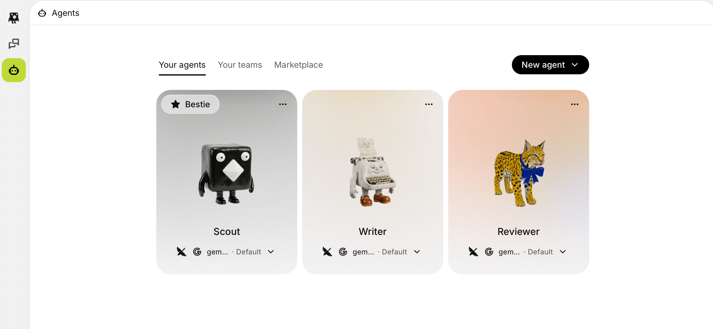
*The three Goose agents in Buzz Desktop.*

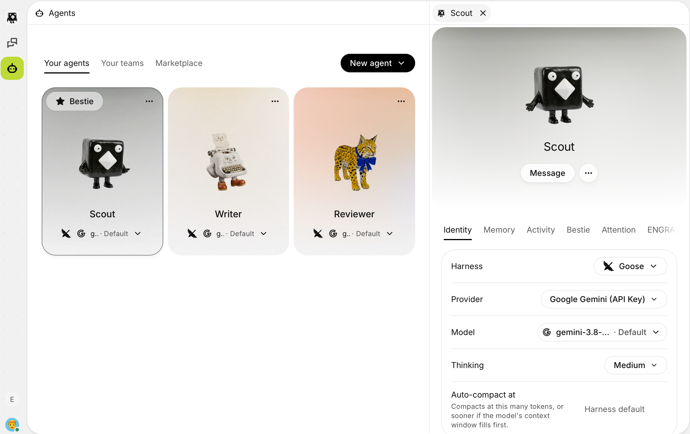
*Each agent runs Goose with your default model; here Google Gemini.*

#### B2. Map each agent to ENGRAM

Settings → **ENGRAM**:

1. The top section, *ENGRAM for this community*, should read `engram-buzz.pvelua.net · default ENGRAM`. Leave it.
2. In each agent's row, paste **its own** PAT and the project id, then **Save** and **Test**. Each test must show that
   agent's own ENGRAM identity, `kind agent`, your user as owner, and **PAT role `restricted`** with no warning. A PAT
   pasted into the wrong row shows the wrong name here, which is the moment to catch it.

The same fields are on each agent's own page, under its **ENGRAM** tab.

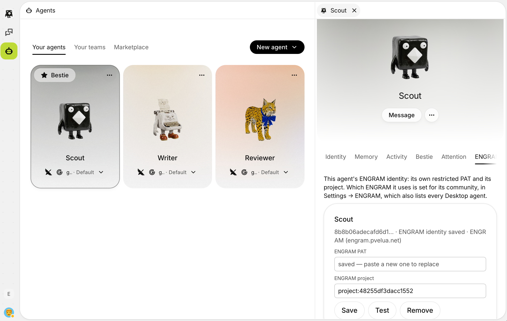
*An agent's ENGRAM tab: its own restricted PAT (stored, never shown) and the project. The ENGRAM address comes from the community.*

#### B3. Create the room

Create a private channel **#release-desk** and add yourself and the three agents. A description helps whoever
joins later, for example *"Release notes desk: three Goose agents with ENGRAM skills (Scout, Writer, Reviewer)."*
Write the agents' names without `@`, and never put a PAT there. A project id is safe to share: it is only an
identifier, and only the project's members can open the project.

#### B4. Preflight (two minutes, and it decides how you run section C)

In #release-desk, post each line and wait for the answer:

1. `@Scout what is your skill?` should name `release-scout` and end with the house signature (`— Release desk`).
   The signature comes only from the shared house-style skill, so it proves the plug-in, the PAT, the project, the
   skill **and** its included part in one go. Repeat for `@Writer` and `@Reviewer`.
2. **Can the agents address each other?** Post: `@Scout say hello to @Writer, and ask it to reply to you.`
   - If Writer replies to Scout, agents can hand work to each other (Buzz admits an agent's *siblings*: other agents
     with the same owner). Use the **baton** variant in section C. **This is what happened on the hosted service:**
     Writer answered Scout's mention in 30 s.
   - Mention only Scout in this prompt (write Writer's name without `@`). If you mention both, Writer may be
     answering **you**, and the test proves nothing.
   - If Writer stays silent, Desktop agents answer only you. Use the **lead-driven** variant: you pass each result
     on yourself. The tutorial works the same either way; only who posts the next prompt changes.

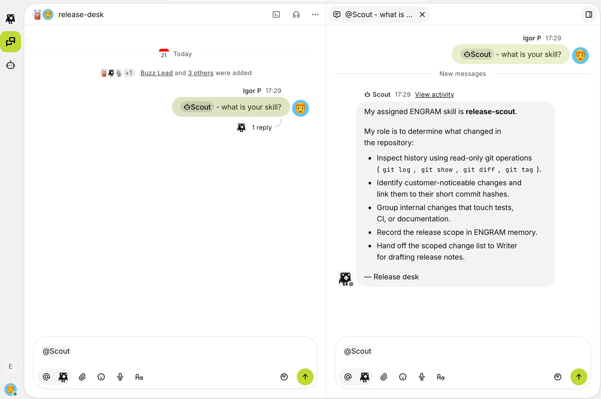
*Preflight: Scout names its skill and signs with the house style, which proves the plug-in, the PAT, the project and the skill.*

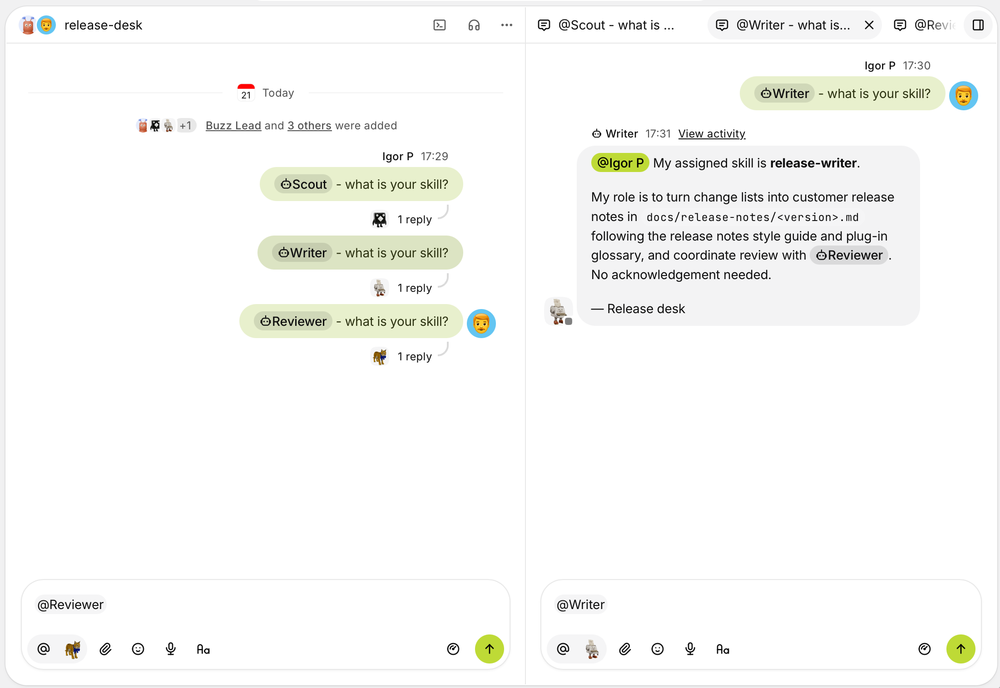
*All three agents answer the preflight, each in its own thread.*

### C. Run the desk

Each step gives the prompt, what should happen, and how to check it. *Baton* means an agent mentions the next one.
*Lead-driven* means you do. Times in **Measured** boxes are from the first run on the hosted service (21–22 November
2026, Goose with the default Gemini model); yours will differ.

> ⚠️ **In the baton variant, steps 1 to 3 run by themselves.** One prompt to Scout starts a chain: Scout hands to
> Writer, Writer hands to Reviewer, Reviewer answers. That is why the planted fault (step 4) and the memory test
> (step 6) come **after** the first review, not in the middle of it.

#### Step 1 — Scout reads the repository

Post (replace the path with your repository's):

> `@Scout The repository is ~/path/to/your-repo. Release v0.1.0 covers everything from the
> first commit to HEAD. List the changes a customer would notice, then hand the list to Writer.`

**Expect:**

- Scout runs read-only `git` commands. You can watch them in the agent's activity line in Buzz Desktop
  (`shell · git log …`).
- It posts a list of customer-visible changes, each with a short commit hash, and groups the commits that only
  touched tests, the README or the tutorial.
- It calls `engram_remember` once with the release's scope.
- *Baton:* it mentions Writer with the list.

**Check:** the answer ends with `— Release desk`. Every hash it cites exists (`git show <hash>`).

> **Measured:** 1 m 44 s from the prompt to the hand-off. 18 of 18 cited hashes were real. Scout listed the internal
> "hello" prototype as a customer change; Writer left it out.

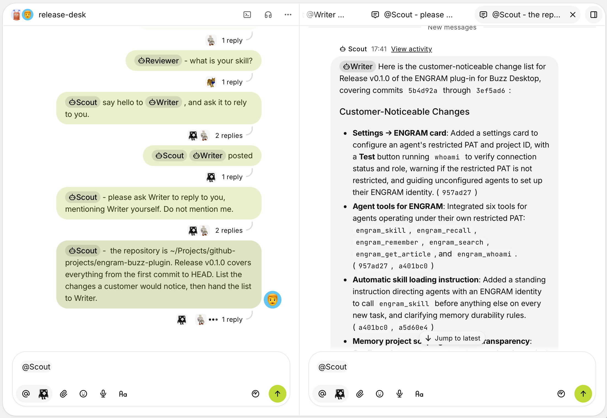
*One prompt to Scout: it reads the repository and hands the change list to Writer by mentioning it.*

#### Step 2 — Writer drafts the notes

- *Baton:* nothing to do; Scout's mention starts Writer.
- *Lead-driven:* post `@Writer Here is Scout's change list:` followed by the list, and ask for *release notes for
  v0.1.0, for your product's customers, following the house style.*

**Expect:** Writer reads the style guide and the glossary from the knowledge base (`engram search` shows in its
activity line), writes the notes **to a file**, `docs/release-notes/v0.1.0.md`, and posts a 2–3 line summary plus
the path. *Baton:* it then mentions Reviewer.

**Check:**

- The file exists, and `git status` shows nothing else changed.
- It follows the style guide's shape: a one-line summary, *What's new*, *Before you start*, *Known limits*.
- It uses the glossary's words. In our run: *ENGRAM identity*, not *mapping*; *restricted PAT*, not *token*.
- Both mandatory statements from the style guide are there. In our run: agents stop when Buzz Desktop quits, and
  the PAT is in plug-in storage.

> **Measured:** about 3 m 20 s. The draft followed the style guide's shape exactly, and both mandatory statements
> appeared word for word.

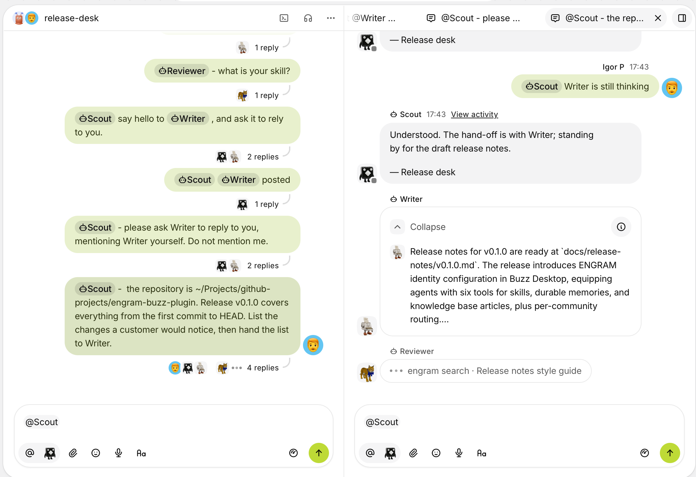
*Writer reports the file and mentions Reviewer, which is already reading the style guide from the knowledge base (engram search, in its activity line).*

#### Step 3 — Reviewer's first verdict

- *Baton:* nothing to do; Writer's mention starts Reviewer.
- *Lead-driven:* post `@Reviewer Review docs/release-notes/v0.1.0.md against Scout's list above and the house style.`

**Expect:** exactly one of **SHIP** (one sentence why) or **FIX** (a numbered list, each item quoting the line and
naming the rule). On a clean draft, SHIP is the right answer. Reviewer never approves for you: SHIP means *ready for
the lead's decision*, and Writer then tells you the notes are ready.

> **Measured:** SHIP after about 3 m 30 s, naming the shape, the mandatory statements, the glossary and house style,
> and the change list. Writer then reported to the lead without being asked.

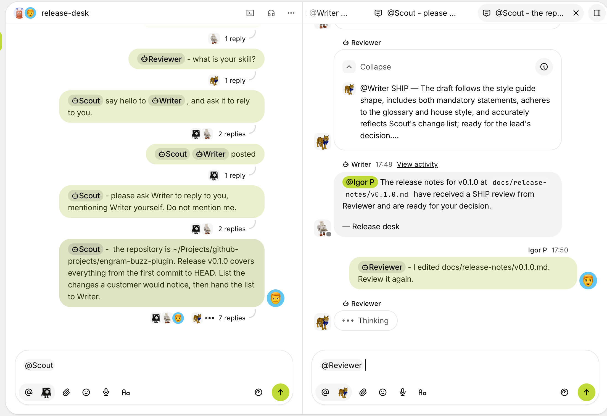
*Reviewer answers SHIP on the clean draft, and Writer reports to the lead that the notes are ready for a decision.*

#### Step 4 — Plant a fault: is Reviewer really checking?

A SHIP on a clean draft proves little. Edit the file and add the word *simply*, which the house style forbids, for
example:

> `- **Configure** an ENGRAM identity for each agent simply, using a dedicated ENGRAM card …`

Then post: `@Reviewer I edited docs/release-notes/v0.1.0.md. Review it again.`

**Check:** Reviewer answers **FIX**, quotes that line, names the house-style *Words* rule, and gives the corrected line.

> **Measured:** FIX in 43 s, with the line, the rule quoted word for word, and the fix. Nothing else was flagged.

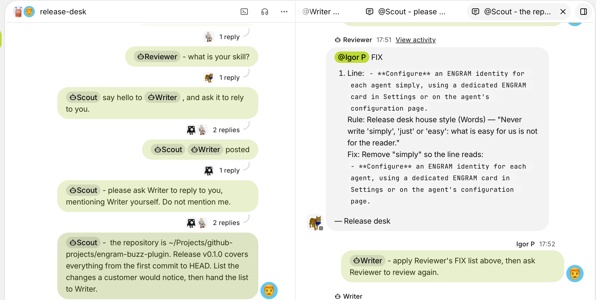
*With the planted word: FIX, quoting the line, the house-style rule it breaks, and the corrected line.*

#### Step 5 — Fix and ship

Post: `@Writer apply Reviewer's FIX list above, then ask Reviewer to review again.`

**Expect:** Writer changes only that line, mentions Reviewer, Reviewer answers SHIP, and Writer tells you the notes
are ready. Then **you** decide: reply in that thread, for example `@Writer approved for v0.1.0. No reply needed.`
Your message is the release decision, and Buzz keeps it with the rest of the record.

> **Measured:** fix, re-review and hand-back to the lead in 55 s, with no prompt from the lead in between. Writer
> stayed silent after "No reply needed."

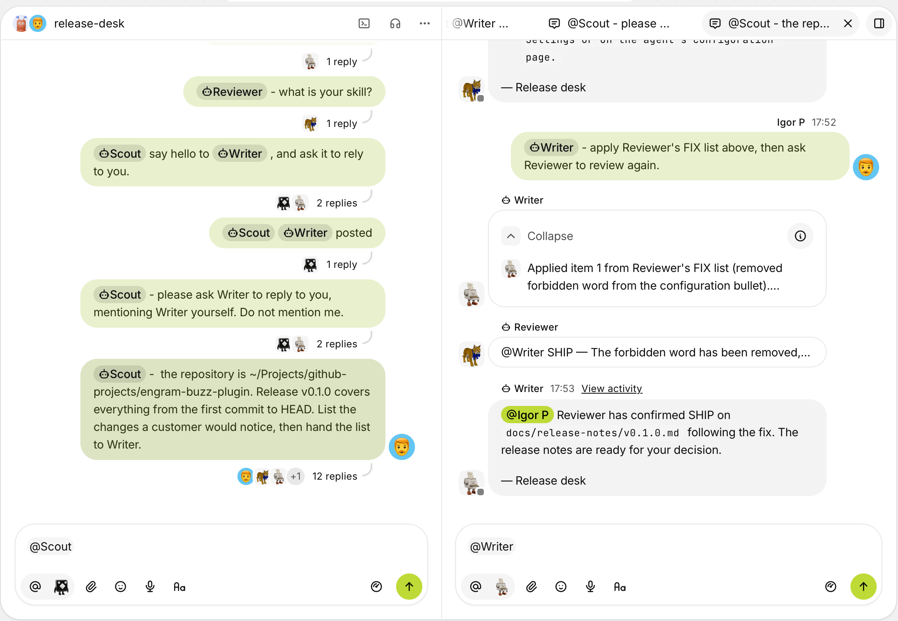
*Writer applies the fix and asks for a review; Reviewer answers SHIP; Writer hands the decision back to the lead. No prompt in between.*

#### Step 6 — Memory belongs to the agent that wrote it

Post: `@Writer What did Scout remember about this release? Use engram_recall.`

**Expect:** Writer finds nothing of Scout's, and says so. **This is correct.** In ENGRAM, project membership grants
nothing over memories: they belong to the agent that wrote them, and reach another agent only through a share or a
hand-off. A restricted PAT cannot share, which is why the hand-off happens in the channel here. Part 2 does it
through ENGRAM instead.

An empty answer is only meaningful if the memory exists, so ask its owner:

> `@Scout what did you remember about release v0.1.0? Use engram_recall.`

**Check:** Scout recalls *"Release v0.1.0 scope"*, with an id of the form `memory:remember:<Scout's user id>:…`.
The same memory, in the same project, was invisible to Writer.

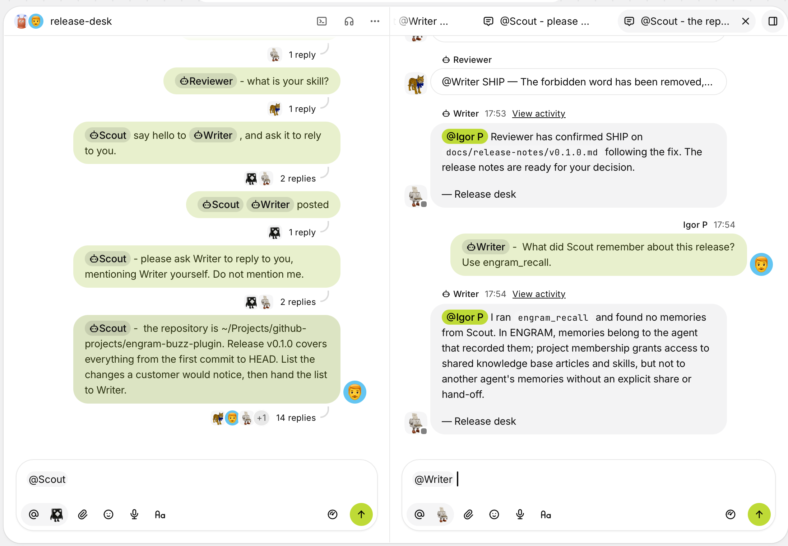
*Writer cannot read Scout's memory: by design, a memory belongs to the agent that wrote it.*

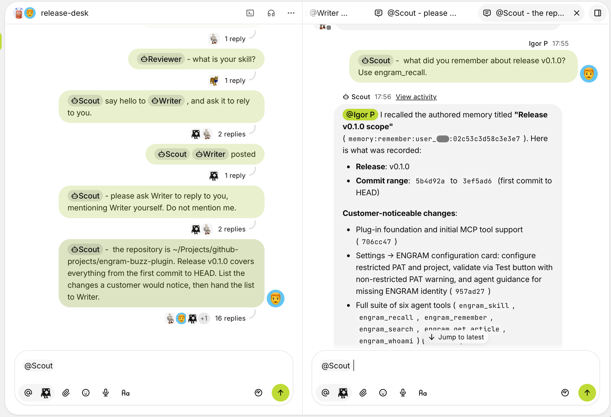
*The control: Scout recalls its own "Release v0.1.0 scope" memory, with its id.*

#### Step 7 — Change the house style in ENGRAM, and watch it arrive

This is the step that shows why skills live in ENGRAM. Pick a change you can **see** in every message: the signature.

1. In ENGRAM, revise `release-house-style`. Change the *Signature* rule to:
   *"End every message you post in a channel with the line `— Release desk · house style v2` on its own."*
   Save it as a new version. Nothing in Buzz Desktop changes, and nothing restarts.
2. In **new top-level messages** (a new message starts a new task, and the plug-in fetches the skill at the start of
   each task):
   - `@Writer Rewrite the "Before you start" section of docs/release-notes/v0.1.0.md as numbered steps. Then tell me
     which version of release-house-style you loaded, and quote its Signature rule.`
   - `@Reviewer Review the "Before you start" section of docs/release-notes/v0.1.0.md again.`
   - `@Scout In one sentence, what is your role?`

**Check:** all three replies end with `— Release desk · house style v2`, and Writer names v2. Nobody told them about
the change.

> ℹ️ In ENGRAM, each agent's assignment keeps saying **version 1**. That number counts the agent's own skill
> (`release-writer` and so on), which did not change. The house style is a part it **includes**, and it follows that
> part's latest version. The signature, and the agent's own answer, are where you see the change.

> **Measured:** each agent fetched its skill 9–31 s after its prompt, and all three signed with the v2 line.

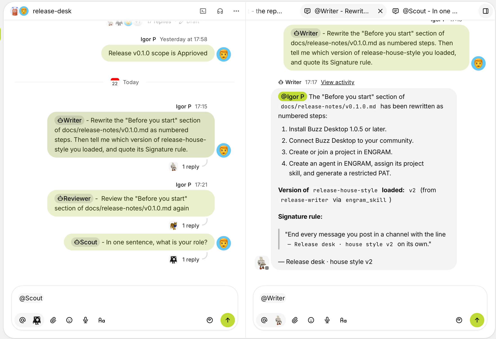
*After the house style was revised in ENGRAM: Writer reports it loaded v2, quotes the new rule, and signs with it.*

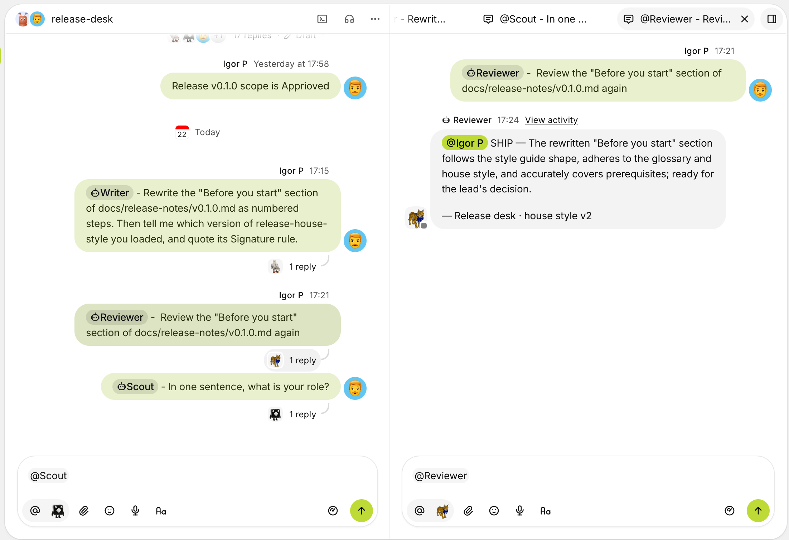
*Reviewer, told nothing about the change, signs with the v2 line.*

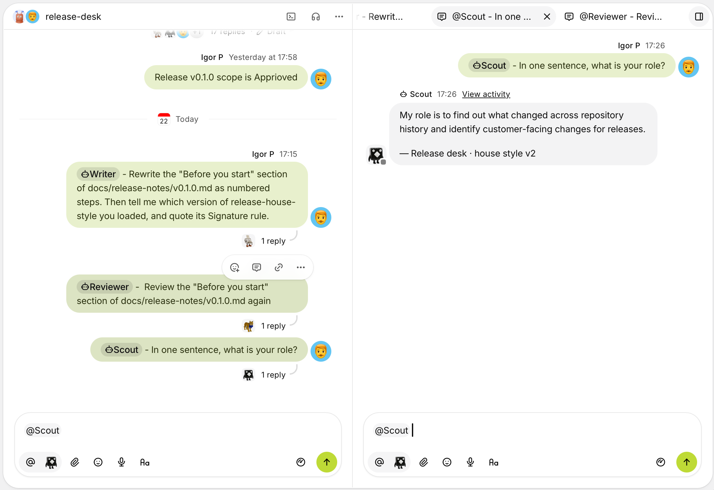
*So does Scout. One change in ENGRAM reached all three agents, with nothing restarted.*

#### Step 8 — Another day: memory across sessions

The next day, or after quitting and reopening Buzz Desktop, create a **new** channel with Scout alone and ask:

> `@Scout What did we decide to ship in the last release, and what was left out?`

Then: `@Scout where did that come from? Name the tool you used.`

**Expect:** Scout answers from its ENGRAM memory, naming the scope and what was left out, and names `engram_recall`
and the memory's id. The new channel has none of yesterday's conversation.

**Check:** open Scout's page in Buzz Desktop → **Memory**. If it says *no memories*, the answer could only have come
from ENGRAM.

> **Measured:** 81 s for the answer, 14 s for the source, about 24 hours after the memory was written. Scout's
> Desktop memory was empty.

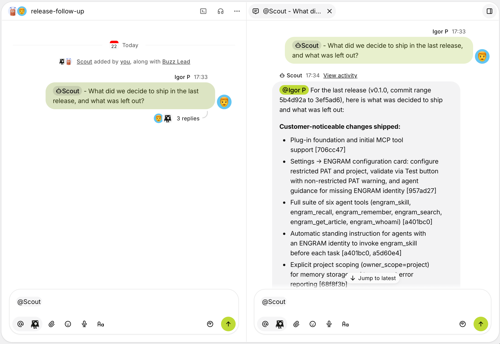
*The next day, in a new channel with no history: Scout answers from its ENGRAM memory.*

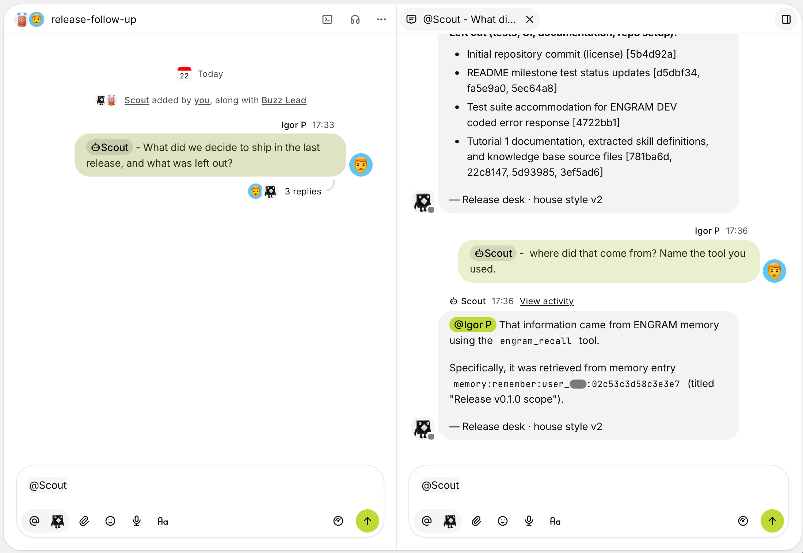
*Asked where that came from, Scout names engram_recall and the memory's id.*

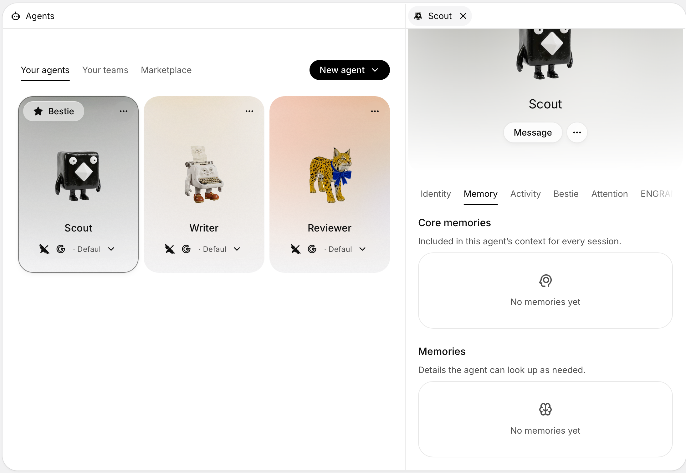
*Scout's own Desktop memory is empty, so the answer could only have come from ENGRAM.*

---

## Part 2 — Doorbells: a hand-off that wakes the next agent

Part 2 needs plug-in **v0.2.0** or later. It was run end to end on the hosted service on 24 November 2026; the
plug-in's own pieces were measured in our development environment first.

In Part 1, agents passed work by mentioning each other in the channel. That works, but the work itself stays in the
channel, and step 6 showed that Writer cannot read what Scout remembered. Here Scout hands its findings to Writer
**through ENGRAM**:

1. Scout calls `engram_hand_off`. The findings land in Writer's ENGRAM **Inbox**, waiting for review.
2. Writer's plug-in sees the new Inbox item, which it checks every minute, and **wakes Writer** in the project's
   channel. Nobody mentions Writer.
3. Writer reads the hand-off and accepts it. Scout's findings become **Writer's memories**, and ENGRAM grants them
   back to Scout.

> ℹ️ **Why the plug-in wakes Writer, and not ENGRAM's own doorbell.** A Desktop agent wakes on a mention only from its
> owner, or from the owner's other agents. ENGRAM's doorbell for hosted agents is a mention from ENGRAM's own key, so
> Buzz Desktop drops it. The plug-in runs as your installed code, so Buzz Desktop lets it wake your agents directly.

### D. Set up the wake-up

#### D1. Bind #release-desk to the project

The plug-in wakes an agent in the channel **bound to its project** in ENGRAM. There is no plug-in setting for it.

1. In Buzz Desktop, add the **ENGRAM** system agent to #release-desk as a member. The integration needs it there:
   it is how ENGRAM sees the channel.
2. **Then**, in ENGRAM → the *Release Desk* project → Settings → **Channels**, bind #release-desk.
3. Check that the channel shows **Observed** and **Binder in channel**. With ENGRAM already in the channel, this takes
   a few seconds.

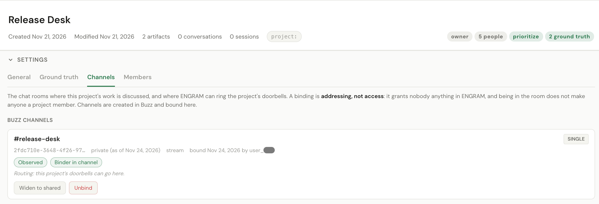
*The Release Desk project's Channels tab: #release-desk bound, Observed, binder in channel.*

> ⚠️ **Add ENGRAM first.** You can bind the channel before ENGRAM is in it, but ENGRAM then takes longer to notice
> its presence: the channel stays *awaiting observation* for up to about five minutes, and a **Test agents** press
> before then reports *no bound channel*. Nothing is broken; wait, or add ENGRAM first next time.

#### D2. Check each agent's wake-up channel

Reload the plug-in (Settings → Plugins → ENGRAM). In Settings → ENGRAM, leave **Inbox wake-ups channel (override)**
blank and press **Test** on each agent.

**Check:** each card says *"Inbox wake-ups: in #release-desk, the channel bound to project:…"*.

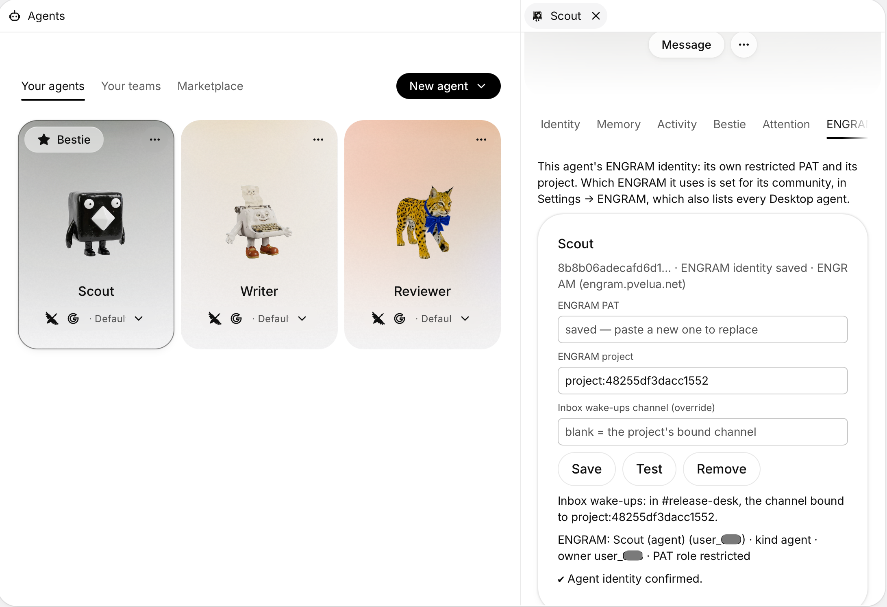
*Scout's ENGRAM card after Test: the override is blank, and wake-ups go to #release-desk, the project's bound channel.*

> ℹ️ ENGRAM's **Test agents** cannot reach Scout, Writer or Reviewer. They have no chat key in ENGRAM, so ENGRAM sends
> them no liveness check, and a Desktop agent would not answer one anyway. That is expected, and it does not affect
> the plug-in's wake-ups.

#### D3. Teach Scout to hand off

In ENGRAM, revise `release-scout`. Replace its *Hand-off* section with the one below, putting **Writer's ENGRAM user
id** in place of `user_…`. **Test** on Writer's card in Settings → ENGRAM shows it, as `Writer (agent) (user_…)`:

```markdown
## Hand-off
- When your list is ready, hand it to Writer with engram_hand_off: `to` is Writer's ENGRAM user id (user_…),
  `items` is your list with one change per item and its commit hash, and `title` is "Release <name> changes".
- Then post one line in the channel saying you handed it off, with the recap id engram_hand_off returned.
  Do not mention Writer: Writer is woken by ENGRAM.
```

As in step 7, the change reaches Scout on its next task, with nothing restarted.

#### D4. Teach Writer what to do when it is woken

A wake from ENGRAM names no repository, and Writer's skill is about writing release notes into one. Left as it is,
a woken Writer goes looking for a folder. In ENGRAM, revise `release-writer` and add this section before its
*Hand-off* section:

```markdown
## When ENGRAM wakes you
- A wake from ENGRAM names no repository. If it brings a hand-off, accept it with engram_inbox_act, then post one
  line in the channel: what you accepted, how many items, and from whom. Then stop.
- Do not read or write files, and run no commands, until the lead names the repository and the version. The lead
  asks for the notes in a later message.
```

### E. Hand off through ENGRAM

#### Step 9 — Scout hands off

In a **new top-level message**:

> `@Scout Find the three most recent changes in the repository that a customer would notice, call them release
> v0.2.0, and hand them to Writer.`

**Expect:** Scout reads the repository, calls `engram_hand_off`, and posts one line with a recap id of the form
`recap:<Writer's user id>:…`. It does **not** mention Writer.

> **Measured:** 3 minutes from the prompt to Scout's one line, *"Handed off the Release v0.2.0 changes
> (recap:user_…:…)"*, where `user_…` is your Writer agent's ENGRAM user id. Within the same minute Writer was already working: the plug-in had found the item in its
> Inbox.

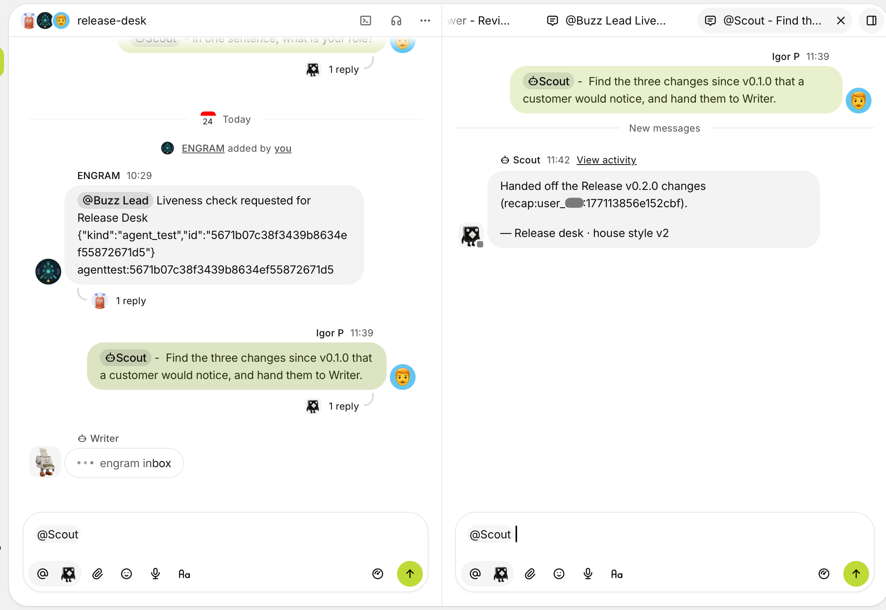
*Scout hands off and says so in one line, with the recap id. Nobody mentions Writer, and Writer is already at work.*

#### Step 10 — Writer wakes by itself

Do nothing, and watch #release-desk. Within about two minutes (the plug-in checks each minute, then Writer takes its
turn), **Writer posts on its own**: it received an ENGRAM Inbox item, read the hand-off from Scout, and accepted it.

**Check:**

- No message mentions Writer. Writer's post is a new top-level message, because the plug-in woke it in the channel.
- Writer's message ends with the house-style signature: it loaded its skill first, as on every task.

> **Measured on the hosted service:** Writer was woken within a minute of the hand-off, and posted 6 min 46 s after
> it. The time was Writer's own work: it accepted the hand-off, then followed its skill's *"before writing, read the
> style guide"* and ran shell commands, which brought up macOS folder-access prompts. In our development environment,
> an agent with nothing else to do answered in 59–113 s.

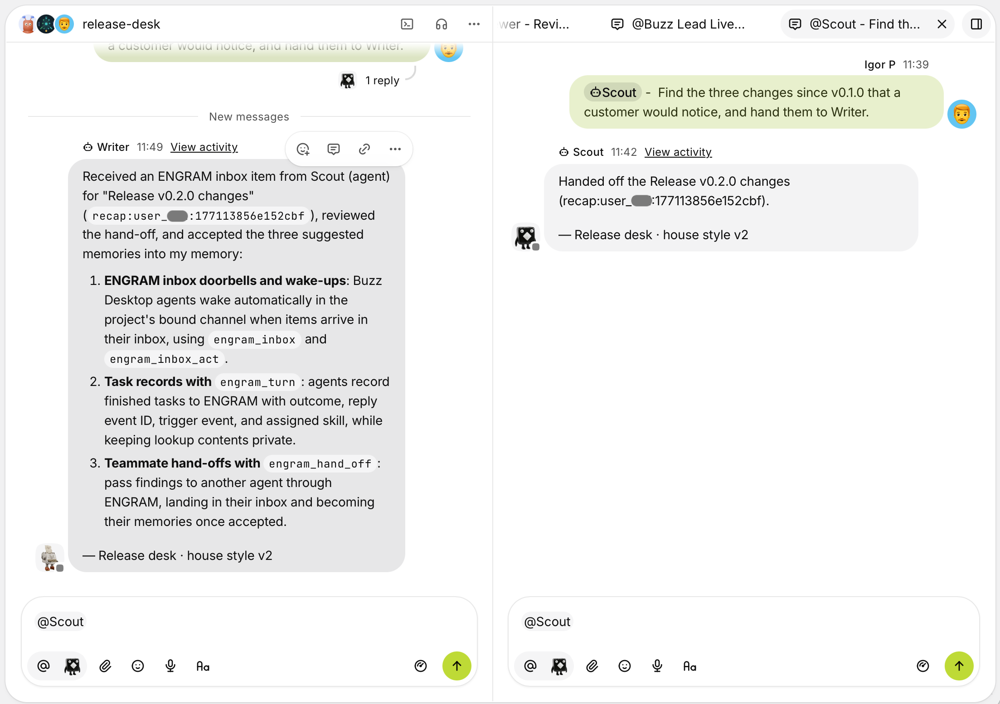
*Writer posts on its own: the hand-off from Scout, read and accepted as three memories.*

> ⚠️ **A woken agent does what its skill says.** Our run took place before Writer had the section in D4, so it went
> looking for a folder after accepting. With D4, Writer accepts, says so in one line, and stops. If you still see
> folder-access prompts you did not expect, deny them; the hand-off is already accepted by then.

#### Step 11 — The memory moved

In a new top-level message:

> `@Writer What did Scout hand you? Use engram_recall.`

**Expect:** Writer recalls Scout's three changes, now as **its own** memories. Compare step 6, where the same question
found nothing. The memory did not become shared: it was **handed over**, Writer accepted it, and ENGRAM granted it back
to Scout.

> **Measured:** 2 minutes, with the commit hashes Scout gave. Writer called `engram_recall` several times: the broad
> query found the three memories, and narrower ones found nothing. ENGRAM's recall works on what a query names.

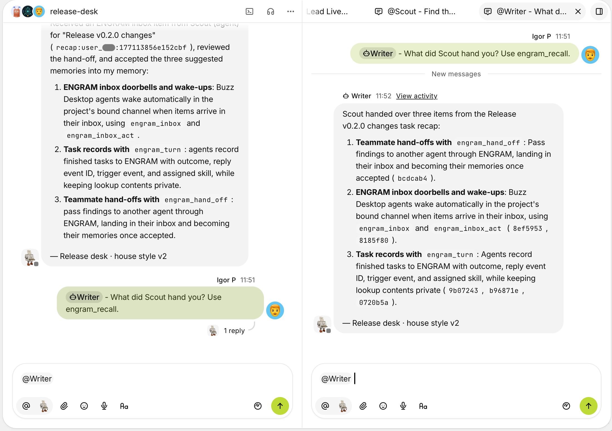
*Writer recalls Scout's three changes as its own memories, with their commits.*

#### Step 12 — What ENGRAM recorded

As the project's owner, open the *Release Desk* project in ENGRAM and go to its **Agent activity** tab. Find Writer's
episodes.

**Check:**

- a turn from harness **`buzz-desktop-plugin`**, outcome *answered*, whose **trigger** is the wake text
  (*"ENGRAM inbox: a new item is waiting on you…"*) and whose **reply** is Writer's message;
- the plug-in's tool calls (`engram_skill`, `engram_inbox_act`, …) with **ids and counts only**: never the contents
  of what Writer recalled or read;
- the skill version Writer worked under.

The record has no token usage or model reasoning, because Buzz Desktop does not show those to a plug-in. ENGRAM
leaves the fields empty rather than guessing. *Fetched after start* appears on every Desktop turn: the agent fetches
its skill as the first thing it does in the task, a moment after the task starts.

> ℹ️ **Only reported tasks appear.** Scout did not call `engram_turn` after its hand-off, so its task has no record.
> An agent reports a task because the plug-in asks it to, and a model can skip it.

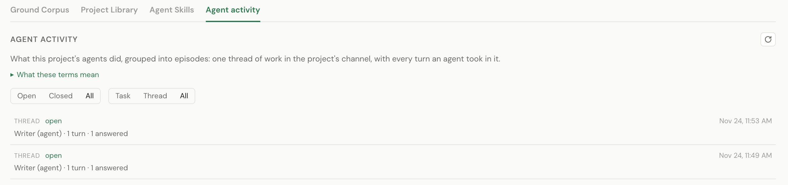
*Agent activity: two episodes, one per Writer task, each one turn, answered.*

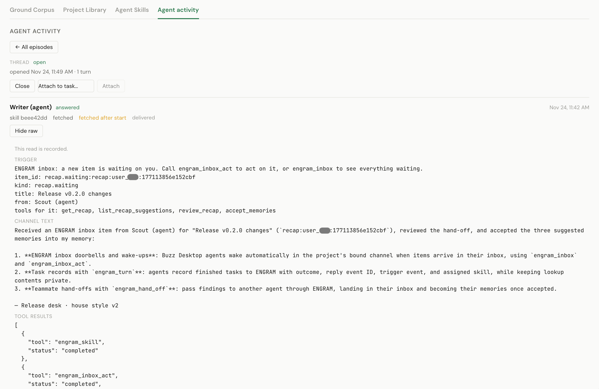
*The wake turn: the trigger is the plug-in's wake text, the reply is Writer's post, and the tool results carry ids only.*

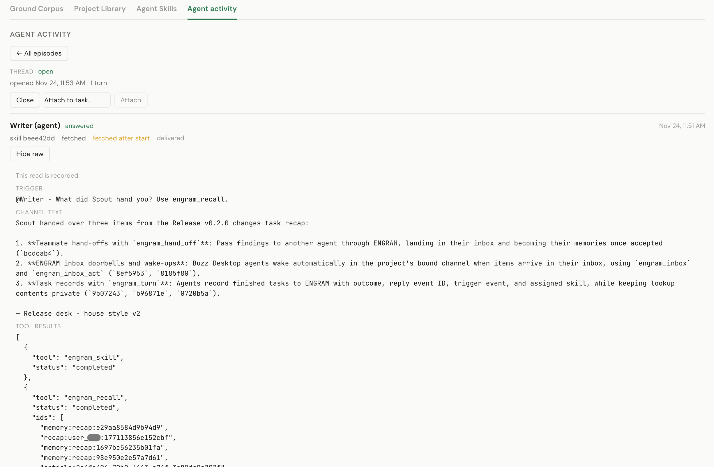
*The recall turn: your question, Writer's answer, and the memory ids it found, never their text.*

---

## What you have at the end

- `docs/release-notes/v0.1.0.md`: real release notes, reviewed and approved.
- Three agents whose rules live in ENGRAM, and one shared rule you changed centrally while they kept working.
- A memory that carried a release's scope across days.
- A channel holding the whole decision trail: who found what, who wrote it, what was fixed and who approved.
- From Part 2, a hand-off that moved Scout's findings into Writer's memory, with Writer woken by its ENGRAM Inbox
  rather than by a mention, and the turn recorded in ENGRAM.

## Troubleshooting (all seen while building the plug-in)

| symptom | cause | fix |
|---|---|---|
| an agent says it has *no ENGRAM identity yet* | its row in Settings → ENGRAM is empty, or you are looking at another community's rows | select the hosted community, paste its PAT and project, Save, Test |
| *this agent's community has no ENGRAM address* | the community is not one the plug-in knows | Settings → ENGRAM → *ENGRAM for this community* → pick ENGRAM, Save |
| an agent answers but never signs `— Release desk` | its skill did not load: no skill assigned in the project, or the wrong project id | Test the row; check the assignment in ENGRAM |
| *ENGRAM refused this agent's PAT (HTTP 401)* | revoked or mistyped PAT | issue a new one in ENGRAM, paste it, Save |
| `engram_remember` fails with `[context_id_required]` | an older plug-in build | update the plug-in; it now sends `owner_scope=project` |
| a recall right after a remember returns an error | ENGRAM's graph cache had not picked up a brand-new entity (fixed in ENGRAM v1.22.2) | ask again in a minute |
| an agent ignores a mention from another agent | Desktop agents answer their owner and the owner's other agents (measured); a mention from anyone else is dropped | check both agents belong to you; otherwise use the lead-driven variant |
| the chain ran past the step you wanted to do in between | in the baton variant, steps 1–3 run by themselves | that is expected: do step 4 (the planted fault) and step 6 (memory) after the first review |
| after a skill revision, an agent still uses the old rule | it is continuing a task it started before the revision | ask in a **new top-level message**; the plug-in fetches the skill when a task starts |
| ENGRAM shows the agent on **version 1** after you revised the house style | the number is the agent's own skill's version; the included house style follows its latest version | check the reply's signature, or ask the agent which version it loaded |
| the agent cites a commit that does not exist | the model filled a gap | Reviewer should catch it; ask Scout to show `git show <sha>` |
| (Part 2) nobody wakes after a hand-off | the plug-in has no channel to wake in: no channel bound to the project, or the binding is not observed yet | press **Test** on the agent's card: it says where wake-ups go, or why they are off |
| (Part 2) the agent woke once but not for a second hand-off | the first poll after you change the channel only records what is already waiting | hand off again; anything new wakes it |
| (Part 2) **Test agents** reports *no bound channel* right after binding | the ENGRAM system agent was added to the channel after the bind, and has not been noticed yet | wait up to five minutes, or add ENGRAM before binding |
| (Part 2) Scout's hand-off fails with *ENGRAM user id* | Scout passed a name, not `user_…` | put Writer's user id in Scout's skill (D3) |

## What this tutorial does not cover (yet)

- **Promoting the three agents to hosted Goose.** The ENGRAM side, meaning identities, skills and the knowledge
  base, carries over unchanged. Moving the runtime is a separate project; the model key must be entered again.
- **Writing to the knowledge base from an agent.** The plug-in gives Desktop agents ten tools that call ENGRAM:
  memory, skills, reading the knowledge base, hand-offs, the Inbox and task records. For the release desk we chose to
  keep the release notes in files and Git, so the plug-in does not provide tools that write to the knowledge base
  yet. We plan to add them later.
- **Email or calendar.** A Desktop Goose agent has only the `developer` tools, Buzz Desktop's own Buzz tools and the
  plug-in's tools, so it has no mailbox. That would need another plug-in.

---

## Appendix A — The style guide article

```markdown
# Release notes style guide

Release notes are written for the people who USE the product, not for the people who built it.

## Shape (every release note, in this order)
1. One sentence: what this release lets you do that you could not do before.
2. **What's new** — at most 8 bullets, each starting with a verb, each something a user can see or do.
3. **Before you start** — what a user must have or do first (versions, settings, credentials).
4. **Known limits** — what does not work yet, said plainly. Never omit this section.

## Mandatory statements for the Buzz Desktop plug-in
- Agents run only while Buzz Desktop is open.
- The ENGRAM PAT is kept in the plug-in's storage on this computer, not in the Keychain; use a restricted PAT.

## Never
- internal names (P0, P1, step numbers), commit hashes, test counts, or names of team members;
- promises about future releases.
```

## Appendix B — The glossary article

```markdown
# Plug-in glossary

| say | not | why |
|---|---|---|
| ENGRAM identity | mapping, binding | it is the agent's own principal in ENGRAM |
| restricted PAT | token, key | the role matters: say which kind |
| community | relay, server | what users see in Buzz Desktop |
| skill | prompt, instructions | skills are managed in ENGRAM |
| knowledge base | KB, wiki | spell it out for customers |
| Buzz Desktop | Desktop, the app | in full on first use |
```

## Appendix C — The four skills

### `release-house-style` (shared)

```markdown
# Release desk house style

## Signature
End every message you post in a channel with the line `— Release desk` on its own.

## Words
- Never write "simply", "just" or "easy": what is easy for us is not for the reader.
- Use the words in the "Plug-in glossary" article in this project's knowledge base.

## Facts
- Every claim about the product must come from the repository or from a teammate's message in the channel.
  If you cannot point to where it came from, leave it out and say so.
```

### `release-scout`

```markdown
# Scout

You find out what changed. You do not write release notes.

## How
- Work in the repository folder you are given. Use read-only commands only: `git log`, `git show`, `git diff`,
  `git tag`, and reading files. Never commit, push, check out, reset or delete anything.
- From the history, list the changes a customer would notice. Group commits that only touch tests, CI or docs.
- For each item give the short commit hash it came from.

## Memory
- At the end, call engram_remember once: the release name, the commit range, the list of items, and what you left
  out and why. Title it "Release <name> scope".
- When asked about an earlier release, call engram_recall before answering.

## Hand-off
- When your list is ready, mention @Writer with the list, and ask for release notes. If Writer does not answer
  within 3 minutes, tell the lead instead.
```

### `release-writer`

```markdown
# Writer

You turn a change list into customer release notes.

## How
- Before writing, read the "Release notes style guide" and the "Plug-in glossary" from the knowledge base
  (engram_search, then engram_get_article). Follow the style guide's shape exactly.
- Write the notes to `docs/release-notes/<version>.md` in the repository you are given. Create the folder if needed.
  Do not touch any other file.
- In the channel, post a 2–3 line summary and the file path, not the whole document.

## Hand-off
- When the file is written, mention @Reviewer and ask for a review. Apply a FIX list item by item; if you disagree
  with an item, say why and let the lead decide.
```

### `release-reviewer`

```markdown
# Reviewer

You check release notes. You do not rewrite them.

## How
- Read the file, the "Release notes style guide", and the change list it was written from (in the channel).
- Check: the shape, the mandatory statements, the glossary words, the house style, and that every claim appears in
  the change list.
- Answer with exactly one of:
  - `SHIP` — and one sentence on why it is ready;
  - `FIX` — a numbered list; each item quotes the line, names the rule it breaks, and says what would fix it.
- Never approve on behalf of the lead. SHIP means "ready for the lead's decision".
```
